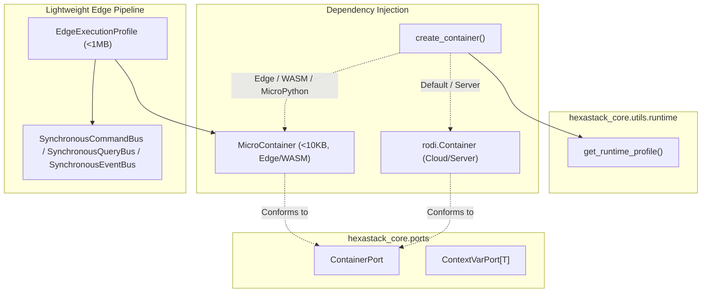

# WASM & MicroPython Lightweight Compilation Profile

> Zero-C-extension, ultra-low-footprint execution profile for running Hexastack CQRS pipelines, domain models, and dependency injection across WebAssembly (Pyodide, WASI), serverless edge workers, and MicroPython embedded targets.

---

## 1. Architectural Overview & Intent

Modern distributed systems increasingly span cloud backend services, browser sandboxes (e.g. Pyodide in client-side devtools), serverless edge compute nodes (e.g. Cloudflare Workers, Fastly Compute via WASI), and resource-constrained IoT microcontrollers (MicroPython).

Standard Python microservice frameworks fail in these environments because they rely on:
- Compiled C-extensions for serialization, DI, or HTTP parsing.
- Multi-threaded worker pools (`asyncio.to_thread`), which raise `RuntimeError` on single-threaded WASM builds.
- PEP 567 `contextvars` modules, which are absent in MicroPython.
- Heavy container footprints that exceed embedded memory limits (e.g. 512KB–4MB RAM).

Hexastack provides a turnkey **WASM & Embedded Edge Profile** ([`ADR-016`](../decisions.md#adr-016-wasm--embedded-edge-execution-profile)) that allows the exact same Commands, Queries, Events, and Domain Entities to run without modification across cloud and edge.



---

## 2. Runtime & Platform Introspection

The [`hexastack_core.utils.runtime`](file:///home/rjdw/Projects/hexastack/packages/hexastack_core/src/hexastack_core/utils/runtime.py) module provides zero-overhead introspection of the active runtime environment:

```python
from hexastack_core.utils.runtime import (
    RuntimeProfile,
    get_runtime_profile,
    is_edge,
    is_wasm,
    is_micropython,
    supports_threads,
    get_memory_footprint,
)

# Inspect detected platform profile
profile: RuntimeProfile = get_runtime_profile()
print(profile.value)  # 'cpython', 'pyodide', 'wasi', 'micropython', or 'pypy'

# Edge and WASM predicate helpers
if is_edge():
    print("Executing in resource-constrained edge runtime")

if is_wasm():
    print("Running inside WebAssembly sandbox (Pyodide or WASI)")

# Concurrency feature detection
if not supports_threads():
    print("Threads unavailable; cooperative event loop required")

# Resource usage audit
stats = get_memory_footprint()
print(f"Allocated memory: {stats.get('allocated_bytes', 0)} bytes")
```

---

## 3. Seamless Dependency Injection: `create_container()`

Hexastack defines an abstract [`ContainerPort`](file:///home/rjdw/Projects/hexastack/packages/hexastack_core/src/hexastack_core/ports/container.py) protocol in `hexastack_core.ports`. The [`create_container()`](file:///home/rjdw/Projects/hexastack/packages/hexastack_core/src/hexastack_core/infra/container.py) factory automatically selects the appropriate implementation:

- **Server/Cloud Runtimes**: Yields `rodi.Container` with full reflection and speed optimizations.
- **Edge/WASM/MicroPython**: Yields [`MicroContainer`](file:///home/rjdw/Projects/hexastack/packages/hexastack_core/src/hexastack_core/infra/container.py), an ultra-lean pure-Python IoC container (<10KB) with single-pass constructor reflection and zero external dependencies.

```python
from hexastack_core.infra.container import create_container
from hexastack_core.ports.container import ContainerPort

# Automatically selects rodi or MicroContainer based on active runtime
container: ContainerPort = create_container()

# Register singletons, transients, and instances
container.add_singleton(UserRepositoryPort, InMemoryUserRepository)
container.add_instance(active_config)

# Resolve with automatic constructor injection
user_repo = container.resolve(UserRepositoryPort)
```

---

## 4. Universal Ambient Context: `create_context_var()`

Ambient context (such as distributed correlation IDs and multi-tenant user contexts) is decoupled from native C-extension `contextvars` via [`ContextVarPort[T]`](file:///home/rjdw/Projects/hexastack/packages/hexastack_core/src/hexastack_core/ports/context.py) and [`create_context_var()`](file:///home/rjdw/Projects/hexastack/packages/hexastack_core/src/hexastack_core/utils/context.py):

- Uses native PEP 567 `contextvars` when available.
- Falls back to pure-Python in-memory token state on MicroPython or restricted runtimes.

```python
from hexastack_core.utils.context import create_context_var, correlation_scope

# Unified context variable conforming to ContextVarPort
tenant_ctx = create_context_var("tenant_id", default="default-tenant")

# Scoped correlation context
with correlation_scope("req-99120"):
    print("Correlation active across synchronous and async calls")
```

---

## 5. Cooperative Concurrency Fallback in `asyncify`

In single-threaded WebAssembly sandboxes (Pyodide without shared-memory pthreads), calling `asyncio.to_thread(func)` raises `RuntimeError: threads not supported`.

Hexastack's [`asyncify`](file:///home/rjdw/Projects/hexastack/packages/hexastack_core/src/hexastack_core/utils/concurrency.py) utility checks `supports_threads()`. When running on single-threaded runtimes, it automatically executes synchronous callables cooperatively directly on the current event loop without thread pool allocation.

```python
from hexastack_core.utils.concurrency import asyncify

def calculate_checksum(data: bytes) -> str:
    # Pure sync computational logic
    return hex(hash(data))

# Safely invocable in both multi-threaded servers and browser WASM
async_checksum = asyncify(calculate_checksum)
result = await async_checksum(b"payload")
```

---

## 6. Lightweight Turnkey Edge Pipeline: `create_edge_pipeline()`

For embedded devices and micro-workers, [`hexastack_cqrs.infra.edge.create_edge_pipeline()`](file:///home/rjdw/Projects/hexastack/packages/hexastack_cqrs/src/hexastack_cqrs/infra/edge.py) boots an in-process, sub-millisecond CQRS execution profile under <1MB memory footprint:

```python
from hexastack_core.domain import Command, Query, Event
from hexastack_cqrs.infra.edge import create_edge_pipeline

class SensorReadingCommand(Command):
    device_id: str
    temperature: float

class GetDeviceStatus(Query[dict]):
    device_id: str

# Create edge execution pipeline with in-memory buses and MicroContainer
edge = create_edge_pipeline()

# Register synchronous or async domain handlers
@edge.register_handler(SensorReadingCommand)
def handle_reading(cmd: SensorReadingCommand) -> str:
    return f"stored:{cmd.device_id}"

@edge.register_handler(GetDeviceStatus)
def handle_status(q: GetDeviceStatus) -> dict:
    return {"device_id": q.device_id, "status": "online"}

# Sub-millisecond dispatch
response = edge.dispatch(SensorReadingCommand(device_id="esp32-1", temperature=22.4))
status = edge.dispatch(GetDeviceStatus(device_id="esp32-1"))
```
