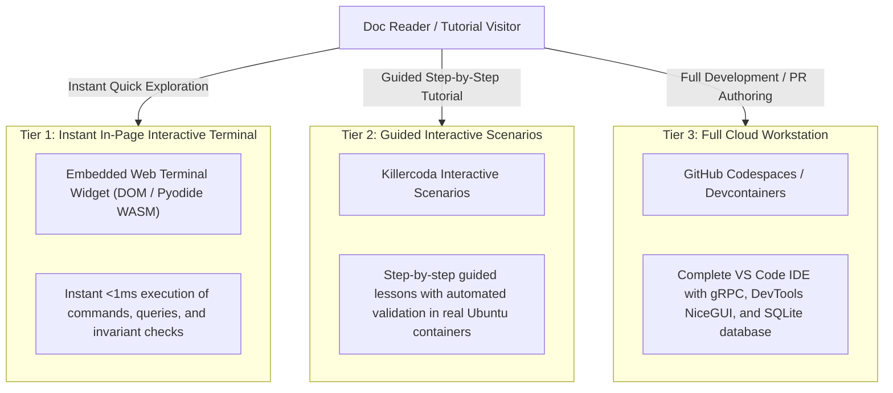

# Interactive Browser Sandbox Terminals & Playgrounds

> Architectural evaluation, security isolation models, and implementation blueprints for embedding interactive terminal sandboxes (TryCLI, Killercoda, Pyodide WASM, and Codespaces) directly within the Hexastack documentation.

---

## 1. Executive Summary & Purpose

Tutorials and documentation frequently suffer from "copy-paste fatigue" — users must switch contexts, clone repositories, install dependencies, and configure local virtual environments before evaluating framework capabilities.

**Hexastack Issue #128** introduces zero-friction interactive sandbox terminals embedded directly within documentation tutorial pages (such as the 7-chapter To-Do app and the Financial Ledger reference architecture). This enables developers to test CLI scaffolding (`hexastack new`), dispatch CQRS commands, evaluate domain invariants, and inspect SQLite persistence with zero local installation.

---

## 2. Sandbox Solution Evaluation Matrix

We evaluated four candidate architectures across latency, resource footprints, security boundaries, and hosting overhead:

| Dimension | **Killercoda** | **TryCLI (Docker Sandbox)** | **Client-Side WASM (Pyodide)** | **GitHub Codespaces** |
| :--- | :--- | :--- | :--- | :--- |
| **Execution Environment** | Cloud Ubuntu Linux VM / Docker | Ephemeral Docker container | Browser WebAssembly runtime | Full VS Code cloud VM |
| **Cold-Start Latency** | 10–15 seconds | 1–3 seconds | **< 1 second** | 20–45 seconds |
| **Interaction Latency** | ~40–80 ms (WebSocket) | ~20–50 ms (WebSocket) | **< 1 ms (Local DOM/WASM)** | ~30–70 ms |
| **Resource Overhead** | Managed by Killercoda | 256MB–512MB RAM per session | **Zero server footprint** (Client RAM) | 2–4 Cores, 8GB RAM |
| **Hosting & Ops Cost** | Free community tier | High (ECS / Fly.io cluster) | **$0 (Static hosting)** | Paid per user compute hour |
| **Filesystem / Persistence** | Full Linux ext4 filesystem | Ephemeral tmpfs / overlayfs | In-memory virtual FS (Emscripten) | Persistent Git worktree |
| **Networking & Egress** | Configurable / Isolated | Egress proxy with dark overlays | Zero external sockets | Full internet access |
| **Embeddability in Docs** | `<iframe>` & Badge links | xterm.js WebComponent | Vanilla JS / xterm.js DOM widget | Badge launch link |

---

## 3. Comparative Architectural Analysis

### A. Killercoda Scenarios
- **How It Works**: Users are provisioned an isolated Linux container with pre-installed `hexastack`, `uv`, and Python 3.12+. The Killercoda scenario engine pairs a terminal on the right with step-by-step instructions and automated verification commands (`verify.sh`) on the left.
- **Strengths**: Zero server management for Hexastack maintainers; full root access allows real SQLite databases, NATS servers, and multi-process gRPC workers to run.
- **Trade-offs**: Requires launching in an iframe or dedicated tab with a ~12s cold-start.

### B. TryCLI Docker Container Daemon
- **How It Works**: A lightweight daemon (e.g. deployed on Fly.io or Kubernetes) listens via WebSockets, dynamically spawns ephemeral Docker containers from a pre-warmed image (`hexastack/sandbox:latest`), and streams standard I/O into an embedded xterm.js canvas in the browser.
- **Strengths**: Sub-3-second startup; branded directly into the documentation stylesheet; fine-grained cgroup limits (128MB RAM, 0.5 CPU).
- **Trade-offs**: Ongoing infrastructure hosting costs and operational monitoring of container lifecycles and rogue network egress.

### C. Client-Side WebAssembly (Pyodide + ADR-016 Edge Profile)
- **How It Works**: Leveraging the [`WASM & Embedded Edge Profile`](edge-profile.md) ([ADR-016](../decisions.md#adr-016-wasm-embedded-edge-execution-profile)), Hexastack domain models, commands, queries, and [`MicroContainer`](edge-profile.md) compile into WebAssembly using Pyodide directly in the reader's browser.
- **Strengths**: **Instantaneous zero-latency interaction (<1ms)**; **zero backend hosting costs**; completely offline-capable; impervious to remote code execution risks since execution is confined to the browser's JavaScript sandbox.
- **Trade-offs**: Limited to single-threaded synchronous and cooperative async execution; cannot bind public TCP listening ports (e.g. real gRPC servers).

---

## 4. The 3-Tier Hybrid Strategy

To maximize user experience, Hexastack adopts a **3-Tier Hybrid Sandbox Strategy**:



1. **Tier 1 (Instant In-Page Terminal)**: Embedded directly into tutorial chapters (e.g. [`financial-ledger.md`](../tutorials/financial-ledger.md) and [`01-building-a-todo-service.md`](../tutorials/todo-app/01-building-a-todo-service.md)). Readers can click interactive command chips or type `hexastack --help`, `hexastack new`, or dispatch ledger transactions with instant simulated output.
2. **Tier 2 (Killercoda Scenarios)**: Provided via 1-click launch badges at the top of multi-chapter tutorials for full terminal walkthroughs with automated check scripts.
3. **Tier 3 (GitHub Codespaces)**: Provided for developers who want a complete, persistent cloud IDE with NiceGUI devtools dashboards and gRPC services.

### Live Tier 1 Interactive Sandbox Terminal

Try the live in-browser terminal widget below — test scaffolding, inspect the ADR-016 WASM microkernel, or dispatch financial ledger transactions:

<div class="hexastack-terminal-container" role="region" aria-label="Hexastack Interactive Sandbox Terminal">
  <div class="hexastack-terminal-header">
    <div class="hexastack-terminal-controls">
      <span class="hexastack-terminal-dot red" aria-hidden="true"></span>
      <span class="hexastack-terminal-dot yellow" aria-hidden="true"></span>
      <span class="hexastack-terminal-dot green" aria-hidden="true"></span>
      <span class="hexastack-terminal-title">Hexastack Sandbox</span>
    </div>
    <div>
      <span class="hexastack-terminal-engine-badge">Instant Simulation (&lt;1ms)</span>
    </div>
  </div>
  <div class="hexastack-terminal-chips" role="toolbar" aria-label="Preset Terminal Commands">
    <button class="hexastack-terminal-chip" data-command="hexastack --help">hexastack --help</button>
    <button class="hexastack-terminal-chip" data-command="hexastack new billing-service">hexastack new billing-service</button>
    <button class="hexastack-terminal-chip" data-command="hexastack edge status">hexastack edge status</button>
    <button class="hexastack-terminal-chip" data-command='dispatch PostTransaction --debit "Cash:500.00" --credit "AR:500.00"'>dispatch (Balanced)</button>
    <button class="hexastack-terminal-chip danger" data-command='dispatch PostTransaction --debit "Cash:500.00" --credit "AR:400.00"'>dispatch (Unbalanced Violation)</button>
    <button class="hexastack-terminal-chip" data-command="clear">clear</button>
  </div>
  <div class="hexastack-terminal-screen" tabindex="0" role="log" aria-live="polite" aria-label="Terminal Output"></div>
  <div class="hexastack-terminal-input-bar">
    <span class="hexastack-terminal-prompt" aria-hidden="true">hexastack &gt;</span>
    <input type="text" class="hexastack-terminal-input" placeholder="Type a command or click a chip above..." aria-label="Hexastack terminal command prompt" autocomplete="off" spellcheck="false" />
    <button class="hexastack-terminal-btn hexastack-terminal-run-btn" aria-label="Execute command">Run</button>
    <button class="hexastack-terminal-btn hexastack-terminal-pyodide-btn" aria-label="Load live Pyodide WebAssembly runtime">⚡ Load Pyodide WASM</button>
  </div>
</div>

---

## 5. Prototype Scenario Specifications

### Scenario 1: CLI Scaffolding & Hexagonal Quality Gates
- **Target Repository**: `TheTrueSCU/hexastack`
- **Killercoda Scenario Path**: `sandboxes/killercoda/scaffolding-playground/`
- **Interactive Steps**:
  1. Initialize a new service: `hexastack new --template minimal my-service`
  2. Inspect the generated directory layout and hexagonal layer boundaries (`domain/`, `ports/`, `adapters/`, `infra/`).
  3. Add a CQRS Command and database repository: `hexastack add command CreateItem`
  4. Run the Hexaqual pre-commit quality gate: `uv run hexaqual sanity`

### Scenario 2: Double-Entry Financial Ledger & Invariants
- **Target Repository**: `TheTrueSCU/hexastack`
- **Killercoda Scenario Path**: `sandboxes/killercoda/financial-ledger-playground/`
- **Interactive Steps**:
  1. Inspect the mathematical invariant: $\sum \text{Debits} == \sum \text{Credits}$ with `Decimal` precision.
  2. Post a balanced $500 transfer from Cash to Accounts Receivable:
     ```bash
     python -m hexastack dispatch PostTransaction --debit "Cash:500.00" --credit "AR:500.00"
     ```
  3. Intentionally post an unbalanced transaction and observe the strict domain rejection:
     ```bash
     python -m hexastack dispatch PostTransaction --debit "Cash:500.00" --credit "AR:400.00"
     # -> Rejection: UnbalancedTransactionError: Debits (500.00) != Credits (400.00)
     ```
