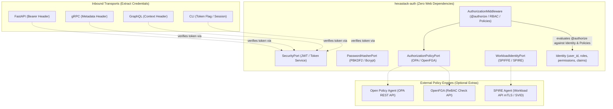

# Hexastack Auth

**`hexastack-auth`** is the security, identity, and authorization engine for the Hexastack framework. It provides protocol-agnostic identity primitives, JWT token creation/verification, PBKDF2 password hashing, and declarative `@authorize` access control across CQRS pipelines (RBAC, OPA Policy-as-Code, OpenFGA ReBAC, and SPIFFE Workload Identity).

[](https://pypi.org/project/hexastack-auth/)
[](https://www.python.org/downloads/)
[](https://codecov.io/github/TheTrueSCU/hexastack)
[](https://dopplereffect.us/hexastack/)
[](https://dopplereffect.us/hexaqual/)
[](https://dopplereffect.us/hexaqueue/)
[](../../LICENSE)

> Part of the [**Hexastack Framework**](https://dopplereffect.us/hexastack/) · Governed by [**Hexaqual**](https://dopplereffect.us/hexaqual/).

---

## 🏛️ Architectural Overview

`hexastack-auth` adheres strictly to Hexagonal Architecture by maintaining zero dependencies on HTTP web frameworks or transport libraries. Presentation adapters (FastAPI, gRPC, GraphQL, MCP, CLI) populate the `Identity` context, and the CQRS `AuthorizationMiddleware` enforces permissions, policies, relationship checks, and workload identity uniformly.



---

## 📦 Features & Optional Extras

| Feature / Engine | Scoped Extra | Key Components | Description |
|---|---|---|---|
| **Core RBAC & JWT** | *(Included by default)* | `JwtSecurityAdapter`, `Pbkdf2PasswordHasher` | Role/permission-based access control, cryptographic token issuance. |
| **OIDC & JWKS Verification** | `hexastack-auth[oidc]` | `JwksOidcSecurityAdapter`, `GenericOidcProvider` | OAuth2 PKCE (`S256`), `.well-known/openid-configuration` discovery, asymmetric JWKS rotation, and bearer ID-token guards. |
| **FastAPI Route Guards** | `hexastack-auth[fastapi]` | `require_bearer_token`, `require_policy`, `require_relation` | HTTP endpoint dependencies enforcing bearer tokens, OPA policies, and OpenFGA relationships. |
| **gRPC Auth Interceptor** | `hexastack-auth[grpc]` | `AuthServerInterceptor` | Server interceptor extracting metadata credentials and SPIFFE IDs into `UserContext`. |
| **Open Policy Agent** | `hexastack-auth[opa]` | `OpaPolicyAdapter` | Policy-as-Code evaluation querying OPA Rego decision endpoints. |
| **OpenFGA ReBAC** | `hexastack-auth[openfga]` | `OpenFgaPolicyAdapter` | Fine-grained relationship-based access control (user can_edit document). |
| **SPIFFE / SPIRE** | `hexastack-auth[spiffe]` | `SpiffeWorkloadAdapter` | Zero-Trust workload identity and service-to-service SVID attestation. |

---

## 🚀 Quickstart

### 1. Configuration (`pyproject.toml` or `hexastack.toml`)

```toml
[hexastack.auth]
secret_key = "your-production-secret-key"
algorithm = "HS256"
token_expire_minutes = 120
provider = "jwt"
hasher = "pbkdf2"

# Open Policy Agent (OPA)
[hexastack.auth.opa]
enabled = true
url = "http://localhost:8181"
policy_path = "v1/data/authz/allow"

# OpenFGA ReBAC
[hexastack.auth.openfga]
enabled = true
api_url = "http://localhost:8080"
store_id = "01HN7K2M9V..."

# SPIFFE / SPIRE Workload Identity
[hexastack.auth.spiffe]
enabled = true
socket_path = "unix:///tmp/spire-agent/public/api.sock"
trust_domain = "example.org"

# OIDC / JWKS Resource Server Verification (hexastack-auth[oidc])
[hexastack.auth.oidc]
enabled = true
issuer = "https://auth.example.com/application/o/hexastack/"
audience = "hexastack-api"
discovery_url = "https://auth.example.com/application/o/hexastack/.well-known/openid-configuration"
algorithms = ["RS256", "ES256", "EdDSA"]
require_access_token_typ = false
reject_id_tokens = true
```

### 2. Protecting CQRS Messages with `@authorize`

```python
from hexastack_core.domain import Command
from hexastack_auth.infra.decorators import authorize, requires_role


# 1. Standard RBAC
@authorize(roles=["admin"], permissions=["users:ban"])
class BanUserCommand(Command):
    user_id: str
    reason: str


# 2. OPA Policy-as-Code
@authorize(policy="policies.finance.approve_invoice")
class ApproveInvoiceCommand(Command):
    invoice_id: str
    amount: float


# 3. OpenFGA Relationship Check (ReBAC)
@authorize(relation="editor", object_type="document", object_id_field="doc_id")
class EditDocumentCommand(Command):
    doc_id: str
    content: str


# 4. SPIFFE Workload Trust (Service-to-Service)
@authorize(spiffe_ids=["spiffe://example.org/ns/prod/sa/billing-service"])
class SyncBillingCommand(Command):
    tx_id: str
```

### 3. FastAPI Route-Level Policy & Relationship Guards

```python
from fastapi import Depends, FastAPI
from hexastack_auth.adapters.fastapi import require_policy, require_relation

app = FastAPI()


# Guard endpoint with OPA Rego policy
@app.get(
    "/reports/confidential",
    dependencies=[Depends(require_policy("v1/data/reports/view"))],
)
async def get_confidential_reports():
    return {"data": "classified"}


# Guard endpoint with OpenFGA ReBAC relation
@app.post(
    "/documents/{doc_id}",
    dependencies=[Depends(require_relation("editor", "document", "doc_id"))],
)
async def update_document(doc_id: str):
    return {"status": "updated", "doc_id": doc_id}
```

### 4. gRPC Server Authentication Interceptor

```python
import grpc
from hexastack_auth.adapters.grpc import AuthServerInterceptor
from hexastack_auth.ports import SecurityPort, WorkloadIdentityPort

security_port = runtime.container.resolve(SecurityPort)
workload_port = runtime.container.resolve(WorkloadIdentityPort)

server = grpc.server(
    futures.ThreadPoolExecutor(max_workers=10),
    interceptors=[
        AuthServerInterceptor(
            security_port=security_port,
            workload_port=workload_port,
            required=False,
        )
    ],
)
```

---

## 🔐 Federated OIDC, PKCE (`S256`), and Reverse-Proxy DevTools Auth

### 5. OIDC Discovery & JWKS Bearer Verification (`RS256` / `ES256` / `EdDSA`)

```python
from typing import Annotated

from fastapi import Depends, FastAPI
from hexastack_auth.adapters.fastapi import create_oauth_router, require_bearer_token
from hexastack_auth.adapters.handlers import UserLifecycleHandlers
from hexastack_auth.adapters.oauth import GenericOidcProvider
from hexastack_auth.adapters.oidc import JwksOidcSecurityAdapter
from hexastack_auth.domain.models import Identity

# Interactive login with OIDC discovery + mandatory PKCE (S256) & nonce
oauth_provider = GenericOidcProvider.from_discovery(
    "https://auth.example.com/application/o/hexastack/",
    client_id="hexastack-devtools-client",
)

# Resource-server bearer validation (rejects HS*/none & OIDC ID tokens)
oidc_security = JwksOidcSecurityAdapter.from_discovery(
    "https://auth.example.com/application/o/hexastack/",
    audience="hexastack-api",
    require_access_token_typ=True,
)

app = FastAPI()
app.include_router(create_oauth_router(oauth_provider, UserLifecycleHandlers()))


@app.get("/api/me")
async def read_profile(
    identity: Annotated[
        Identity,
        Depends(require_bearer_token(oidc_security, required_roles={"admin"})),
    ],
):
    return {"user_id": identity.user_id, "roles": sorted(identity.roles)}
```

### 6. Reverse-Proxy Authentication for Loopback-Only `hexastack-ui` DevTools

Keep `hexastack-ui` bound strictly to `127.0.0.1` (`hexastack ui --host 127.0.0.1 --port 8000`) and terminate TLS + SSO + PKCE authentication in front of it with **`oauth2-proxy`** or **Authelia**:

```ini
# /etc/oauth2-proxy/hexastack-devtools.cfg
provider = "oidc"
oidc_issuer_url = "https://auth.example.com/application/o/hexastack/"
client_id = "hexastack-devtools"
client_secret = "${OIDC_CLIENT_SECRET}"
code_challenge_method = "S256"
redirect_url = "https://devtools.internal.example.com/oauth2/callback"
upstreams = ["http://127.0.0.1:8000"]
http_address = "127.0.0.1:4180"
email_domains = ["example.com"]
set_xauthrequest = true
pass_access_token = true
cookie_secure = true
cookie_httponly = true
cookie_samesite = "lax"
```

```caddyfile
# Caddy + Authelia forward_auth (alternative SSO topology)
devtools.internal.example.com {
    forward_auth 127.0.0.1:9091 {
        uri /api/authz/forward-auth
        copy_headers Remote-User Remote-Groups Remote-Email
    }
    reverse_proxy 127.0.0.1:8000
}
```
